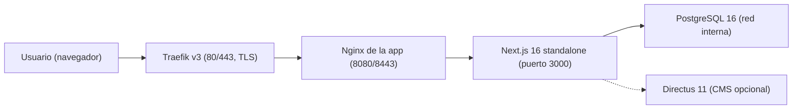

# Plataforma de Gestión de Recursos y Espacios de PLAi

Portal web de la **Plataforma Abierta de Innovación (PLAi)** para consultar, reservar y administrar los equipos y espacios del Laboratorio de Innovación, Robótica y Tecnologías Inmersivas. Proyecto de Estadía Profesional alineado estrictamente con el *Estándar Tecnológico para Proyectos de Software de PLAi v1.0*.

## Propósito

- Catálogo público e interactivo de equipos, categorías, aplicaciones y espacios.
- Solicitud de reservas de equipo con validación en servidor mediante Zod (máximo 2 horas por préstamo normativo).
- Autenticación institucional con NextAuth.js, protección de perímetro con Proxy RBAC en Next.js 16 (`/admin` y `/usuario`).
- Panel de administración (inventario, reservaciones, mantenimiento, usuarios, bitácora, reportes y configuración).
- Portal de usuario institucional (catálogo, mis préstamos y agenda de talleres).
- Base de datos relacional PostgreSQL con migraciones versionadas e idempotentes.

## Arquitectura



| Capa | Tecnología estándar | Cumplimiento normativo |
| :--- | :--- | :--- |
| **Framework** | Next.js 16.4 (App Router) + React 19 + TypeScript 5 (strict) | Sección 3 y 4.1 (`output: 'standalone'`) |
| **Estilos / UI** | Tailwind CSS 4 + daisyUI 5 + lucide-react | Sección 3 (Tailwind 4.x) |
| **Runtime / paquetes** | Node.js 22 LTS + pnpm 11.28.5 (`pnpm-lock.yaml` versionado) | Sección 3 y 5.1 |
| **Base de datos** | PostgreSQL 15/16 + driver `pg` con pool singleton | Sección 3 y 10 (motor relacional único) |
| **Migraciones** | Migraciones SQL versionadas (`database/migrations/`) y runner idempotente | Sección 9 (`pnpm db:migrate`) |
| **Autenticación** | NextAuth.js 4.24 con sesiones JWT en servidor y proxy RBAC | Sección 3 y 7.1 |
| **Validación** | Esquemas estrictos Zod 4.x en servidor con `.superRefine` | Sección 7.2 |
| **Rate Limiting** | Ventana deslizante en memoria en `/api/auth`, `/api/reservas`, `/api/cursos` | Sección 7.3 |
| **Observabilidad** | Logger estructurado en JSON a stdout/stderr + `/api/health` | Sección 8 |
| **Calidad de código** | ESLint 9 (0 errores), TypeScript (0 errores) y Vitest (104 pruebas en verde) | Sección 9 |
| **Contenedor** | Docker multi-etapa alpine, no root (UID 1001), tini, HEALTHCHECK, Swarm | Sección 5.1 y 5.2 |

## Requisitos

- Node.js 22.x
- pnpm 11.x (`corepack enable` respeta el campo `packageManager`)
- PostgreSQL 15 o 16 (o Docker para ejecutarlo en un contenedor)

## Desarrollo local

```bash
# 1. Instalar dependencias
pnpm install

# 2. Configurar variables de entorno
cp .env.example .env.local

# 3. Aplicar migraciones a PostgreSQL y sembrar datos de prueba
pnpm db:migrate
pnpm db:seed-demo

# 4. Iniciar servidor de desarrollo
pnpm dev          # http://localhost:3000
```

### Comandos disponibles

| Comando | Descripción |
| :--- | :--- |
| `pnpm dev` | Inicia el servidor de desarrollo en `http://localhost:3000` |
| `pnpm build` | Compilación de producción (genera `.next/standalone` para Docker) |
| `pnpm start` | Inicia el servidor en modo producción local |
| `pnpm lint` | Analizador estático ESLint 9 (0 errores) |
| `pnpm test` | Suite de pruebas unitarias automatizadas con Vitest (104 pruebas) |
| `pnpm db:migrate` | Ejecuta las migraciones SQL pendientes en PostgreSQL |
| `pnpm db:seed-demo` | Carga los datos de demostración para desarrollo y evaluación |

## Variables de entorno

La plantilla completa y documentada se encuentra en [`.env.example`](.env.example). En producción, los secretos los crea PLAi y se montan como Docker secrets en `/run/secrets/<nombre>` (patrón `VARIABLE_FILE` implementado en `lib/env.ts`).

| Variable | Tipo | Descripción |
| :--- | :---: | :--- |
| `NODE_ENV` | Runtime | `development` o `production` |
| `PORT` | Runtime | Puerto de escucha interno (estándar PLAi: 3000) |
| `HOSTNAME` | Runtime | Interfaz de escucha dentro del contenedor (`0.0.0.0`) |
| `NEXT_TELEMETRY_DISABLED` | Runtime | Desactiva telemetría de Next.js (`1`) |
| `NEXT_PUBLIC_SITE_URL` | Pública | URL pública del sitio (llega al navegador) |
| `DB_HOST` / `DB_PORT` | Red | Host y puerto de PostgreSQL (`5432`) |
| `DB_USER` / `DB_NAME` | Config | Usuario y nombre de la base de datos relacional |
| `DB_PASSWORD(_FILE)` | **SECRETO** | Contraseña de PostgreSQL (Docker secret: `/run/secrets/db_password`) |
| `NEXTAUTH_URL` | Config | URL base para callbacks de NextAuth.js |
| `NEXTAUTH_SECRET(_FILE)` | **SECRETO** | Llave de firma de sesiones JWT (Docker secret: `/run/secrets/nextauth_secret`) |
| `DEMO_LOGIN_ENABLED` | Opcional | Habilita cuentas de evaluación (`false` por defecto en producción) |

## Contenedor Docker y Despliegue en Swarm

```bash
# Construir imagen localmente
docker build -t plai-recursos-espacios:0.1.0 .

# Probar contenedor con las banderas de seguridad exigidas por Swarm (sec. 5.2)
docker run --rm -p 3000:3000 \
  --read-only --tmpfs /tmp --tmpfs /app/.next/cache:size=64M \
  --cap-drop ALL --security-opt no-new-privileges:true \
  plai-recursos-espacios:0.1.0

# Verificar endpoint de salud
curl http://localhost:3000/api/health      # {"status":"ok","timestamp":"..."}

# Escaneo de vulnerabilidades obligatorio antes de entregar (sec. 5.2 y 7.6)
trivy image plai-recursos-espacios:0.1.0 --severity HIGH,CRITICAL
```

Despliegue en producción (lo ejecuta el área de Tecnología de PLAi):

```bash
docker stack deploy -c docker-compose.yml plai-recursos
```

## Estructura del Proyecto

```
app/                        Rutas (App Router), vistas y Route Handlers (/api/*)
  ├── admin/                Backoffice administrativo protegido por Proxy RBAC
  ├── usuario/              Portal de usuario institucional
  ├── api/                  Route Handlers con requireSession y Zod validation
  └── components/           Componentes modulares de interfaz y accesibilidad
database/
  ├── migrations/           Migraciones SQL versionadas (001_..., 002_...)
  └── seeds/                Datos iniciales de prueba (demo_datos.sql)
lib/
  ├── db.ts                 Capa de datos PostgreSQL tipada y transaccional
  ├── pool.ts               Pool singleton pg con soporte de Docker secrets
  ├── auth.ts               Configuración de NextAuth.js
  ├── apiAuth.ts            Guarda de autorización para Route Handlers
  ├── rateLimit.ts          Rate limiter de ventana deslizante
  ├── validations/          Esquemas de validación Zod
  ├── logger.ts             Logger estructurado JSON conforme a LFPDPPP
  └── env.ts                Lector seguro de entorno y Docker secrets
proxy.ts                    Proxy perimetral de seguridad (Next.js 16)
scripts/
  └── migrate.mjs           Runner de migraciones SQL para PostgreSQL
Dockerfile                  Construcción multi-etapa segura (Node 22 alpine, non-root, tini)
docker-compose.yml          Definición de stack Swarm (read_only, cap_drop ALL, Traefik v3)
```

## Lista de Verificación de Aceptación (Sección 11 Estándar PLAi)

| Criterio | Estado | Detalle |
| :--- | :---: | :--- |
| **Arquitectura** | ✅ CUMPLE | Next.js 16.4 + React 19 + TypeScript 5 + Tailwind 4. Sin SaaS de pago. |
| **Dockerfile** | ✅ CUMPLE | Multi-etapa `node:22-alpine3.22`, usuario no root (1001), `tini`, puerto 3000, `HEALTHCHECK`. |
| **Compose (Swarm)** | ✅ CUMPLE | `read_only: true`, `cap_drop ALL`, `no-new-privileges`, `tmpfs`, límites de recursos, sin puertos públicos. |
| **Salud** | ✅ CUMPLE | `/api/health` responde 200 en milisegundos sin autenticación. |
| **Configuración** | ✅ CUMPLE | `.env.example` documentado con variables ficticias; sin datos quemados en código. |
| **Secretos** | ✅ CUMPLE | Lector `lib/env.ts` con patrón `VARIABLE_FILE` y `/run/secrets/`. Sin secretos en Git ni en la imagen. |
| **Autenticación** | ✅ CUMPLE | NextAuth.js 4.24 con sesiones JWT en servidor y proxy perimetral `proxy.ts`. |
| **Seguridad** | ✅ CUMPLE | Validación Zod en servidor, rate limiting en APIs sensibles, sanitización de datos (LFPDPPP). |
| **Datos** | ✅ CUMPLE | PostgreSQL 15/16, migraciones versionadas idempotentes y script seed (`pnpm db:migrate`). |
| **Calidad** | ✅ CUMPLE | ESLint 9 pasa con 0 errores; TypeScript sin errores; 104 pruebas unitarias en verde. |
| **Logs** | ✅ CUMPLE | Logger estructurado en JSON directo a stdout/stderr con sanitización de credenciales. |
| **Documentación** | ✅ CUMPLE | README y guía de montaje detallados en español. |
| **Entrega** | ⏳ PENDIENTE | Transferencia del repositorio a la infraestructura institucional de PLAi. |
