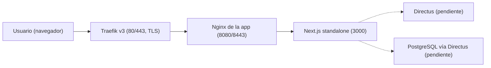

# Plataforma de Gestión de Recursos y Espacios de PLAi

Portal web de la **Plataforma Abierta de Innovación (PLAi)** para consultar, reservar y administrar los equipos y espacios del Laboratorio de Innovación, Robótica y Tecnologías Inmersivas. Proyecto de Estadía Profesional alineado con el *Estándar Tecnológico para Proyectos de Software de PLAi v1.0*.

## Propósito

- Catálogo público de equipos, categorías, aplicaciones y espacios.
- Solicitud de reservas de equipo (máximo 2 horas por préstamo).
- Panel de administración (inventario, reservaciones, mantenimiento, usuarios, reportes) y panel de usuario (agenda y préstamos).

> **Estado actual:** los datos provienen de `lib/mockData.ts`. La integración con Directus (datos administrables) y NextAuth.js (autenticación) está pendiente; ver la sección [Decisiones técnicas](#decisiones-técnicas-y-pendientes).

## Arquitectura



| Capa | Tecnología |
| :--- | :--- |
| Framework | Next.js 16 (App Router) + React 19 + TypeScript (strict) |
| Estilos | Tailwind CSS 4 + daisyUI 5 (tema `plai`), lucide-react |
| Runtime / paquetes | Node.js 22 LTS + pnpm 11 |
| Calidad | ESLint 9, Vitest + Testing Library |
| Contenedores | Docker multi-etapa, stack de Docker Swarm |

El contenedor no publica puertos: PLAi lo publica detrás de Traefik y Nginx por una red overlay. La compilación usa `output: 'standalone'`.

## Requisitos

- Node.js 22.x
- pnpm 11.x (`corepack enable` respeta el campo `packageManager`)
- Docker 24+ (solo para construir la imagen)

## Desarrollo local

```bash
pnpm install
cp .env.example .env.local
pnpm dev          # http://localhost:3000
```

| Comando | Descripción |
| :--- | :--- |
| `pnpm dev` | Servidor de desarrollo |
| `pnpm build` | Compilación de producción (genera `.next/standalone`) |
| `pnpm lint` | ESLint (debe pasar sin errores ni advertencias) |
| `pnpm test` | Pruebas automatizadas con Vitest |

## Variables de entorno

La plantilla completa y documentada está en [`.env.example`](.env.example). Los secretos de producción los crea PLAi y se montan como Docker secrets en `/run/secrets/<nombre>` (patrón `VARIABLE_FILE`).

| Variable | Secreto | Descripción |
| :--- | :---: | :--- |
| `NODE_ENV` | No | `development` o `production` |
| `PORT` | No | Puerto de escucha (3000) |
| `HOSTNAME` | No | Interfaz de escucha (`0.0.0.0`) |
| `NEXT_TELEMETRY_DISABLED` | No | Desactiva la telemetría de Next.js |
| `NEXT_PUBLIC_SITE_URL` | No | URL pública (llega al navegador; no colocar secretos) |
| `DIRECTUS_URL` / `DIRECTUS_TOKEN(_FILE)` | Token | Directus (integración futura, solo servidor) |
| `NEXTAUTH_URL` / `NEXTAUTH_SECRET(_FILE)` | Secreto | NextAuth.js (integración futura) |

## Contenedor Docker

```bash
# Construir
docker build -t plai-recursos-espacios:0.1.0 .

# Probar localmente con las mismas restricciones que Swarm
docker run --rm -p 3000:3000 \
  --read-only --tmpfs /tmp --tmpfs /app/.next/cache \
  --cap-drop ALL --security-opt no-new-privileges:true \
  plai-recursos-espacios:0.1.0

# Verificar salud
curl http://localhost:3000/api/health      # {"status":"ok","timestamp":"..."}
docker ps                                   # STATUS debe indicar (healthy)

# Escaneo de vulnerabilidades (obligatorio antes de entregar)
trivy image plai-recursos-espacios:0.1.0 --severity HIGH,CRITICAL
```

Despliegue (lo ejecuta el área de Tecnología de PLAi):

```bash
docker stack deploy -c docker-compose.yml plai-recursos
```

Los valores marcados como `EJEMPLO` en [`docker-compose.yml`](docker-compose.yml) (registro, dominio, red overlay) deben sustituirse por los que indique PLAi. Límites declarados: 0.5 CPU y 512 MB de memoria.

## Estructura

```
app/            Rutas (App Router), componentes y /api/health
lib/            Datos y lógica de negocio (reservation.ts) con sus pruebas
Dockerfile      Imagen multi-etapa (deps > build > runtime)
docker-compose.yml  Stack de Swarm
```

## Decisiones técnicas y pendientes

- **Estilos (sección 3 del estándar):** el estándar fija Tailwind CSS 4.x. La migración desde CSS Modules es **progresiva**: los componentes compartidos ya usan Tailwind/daisyUI y los módulos restantes coexisten gracias a que el reset global vive en `@layer base`. El avance se registra en `PENDIENTES.md`.
- **Autenticación y datos:** pendientes de integrar con NextAuth.js (proveedor que indique PLAi) y Directus. Hoy el login y los paneles son maquetas con datos de ejemplo.
- **Reserva de equipos:** la regla de duración vive en `lib/reservation.ts` y está cubierta por pruebas.

## Lista de verificación (sección 11)

| Área | Estado |
| :--- | :--- |
| Arquitectura | Stack dentro de la sección 3; estilos en migración a Tailwind |
| Dockerfile | Multi-etapa, `node:22-alpine3.22`, usuario 1001, puerto 3000, HEALTHCHECK, tini |
| Compose | `read_only`, `cap_drop ALL`, `no-new-privileges`, límites, sin `ports` |
| Salud | `/api/health` responde 200 sin autenticación |
| Configuración | `.env.example` documentado; sin configuración de ambiente en el código |
| Secretos | Ninguno en el repo; Docker secrets previstos |
| Seguridad | Trivy pendiente de ejecutar con Docker disponible |
| Autenticación | Pendiente (NextAuth.js) |
| Calidad | `pnpm lint` y `pnpm test` pasan |
| Datos | Sin base de datos aún; migraciones no aplican por ahora |
| Logs | stdout/stderr; sin datos sensibles |
| Documentación | Este README |
| Entrega | Pendiente de transferir el repositorio a PLAi |
